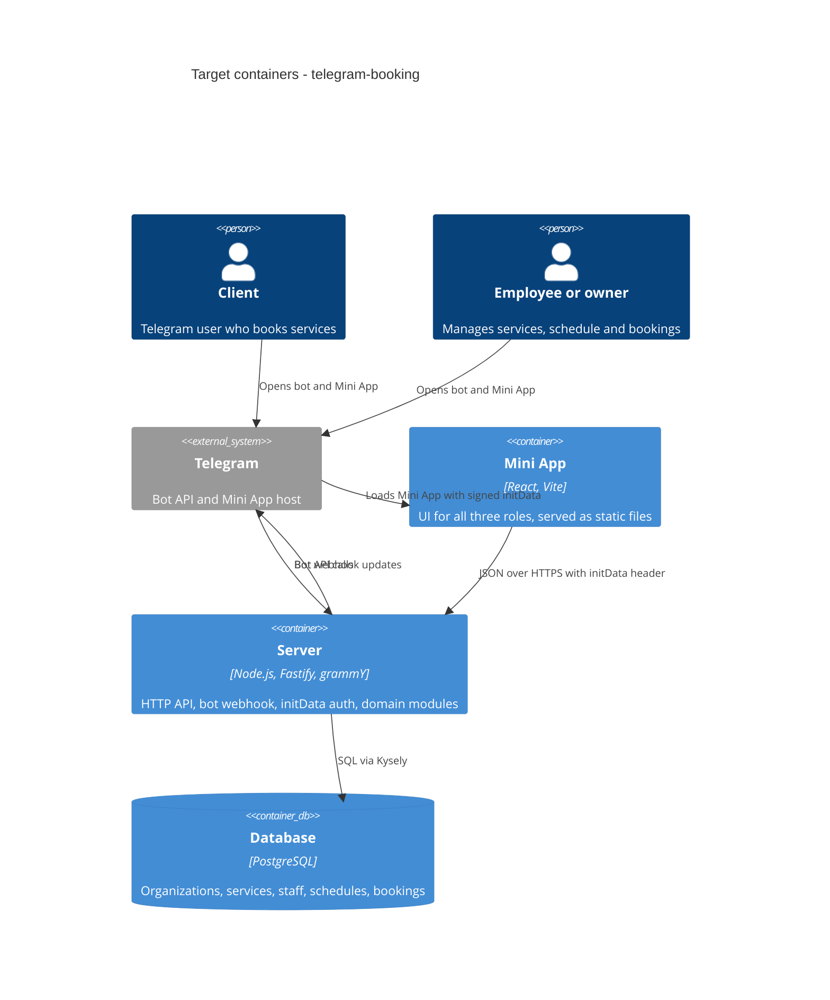

# Architecture map — agent_workflow (telegram-booking)

> **Target foundation**, not a scan: the repo has no source yet (only `docs/`, `idea.md`, `README.md`).
> Decided with the owner in the greenfield `survey` session on 2026-10-30, as a confirmed default bundle.
> `scaffold` materializes this baseline. After that, re-run `survey` so the map describes
> the real code. Product intent comes from `docs/idea-brief.md`.

## Stack

- Language / runtime: TypeScript on Node.js 24 LTS. pnpm workspaces monorepo (decided, [ADR-0001](adr/0001-use-a-typescript-monorepo-with-a-single-deployable-server.md)).
- Backend: Fastify (HTTP API) and grammY (Telegram bot, webhook mode) in one server process.
- Frontend: React + Vite Telegram Mini App, built on these libraries:
  - `@telegram-apps/sdk-react` (Mini App bridge, `initData`, theme)
  - `@telegram-apps/telegram-ui` (Telegram-styled components)
  - TanStack Query (server state)
- Shared contract: zod schemas in `packages/shared`, used for HTTP validation on the server and for typing on the client.
- Datastore: PostgreSQL, accessed through Kysely (decided, [ADR-0003](adr/0003-use-postgresql-with-kysely-and-up-down-migrations.md)).
- Build / test / lint: `pnpm build` · `pnpm test` (Vitest; integration via Testcontainers Postgres) · `pnpm lint` (Biome) · `pnpm typecheck` (`tsc --noEmit` per package).

## C4 — target baseline

## Module inventory

All of the following is the target. Nothing exists yet.

| Module | Path | Layers | Wired at | Responsibility |
|---|---|---|---|---|
| server app | `apps/server/src/` | composition root | `apps/server/src/main.ts` (target) | Builds the Fastify app, registers module routes, mounts the grammY webhook, serves the `apps/web` build |
| identity | `apps/server/src/modules/identity/` | domain/app/infra/http | `apps/server/src/main.ts` (target) | Validates `initData`, resolves the Telegram user and their role per organization |
| organizations | `apps/server/src/modules/organizations/` | domain/app/infra/http | same | Organization profile, address, IANA timezone |
| services | `apps/server/src/modules/services/` | domain/app/infra/http | same | Service catalog: name, price, duration in multiples of 30 minutes |
| staff | `apps/server/src/modules/staff/` | domain/app/infra/http | same | Employees, their profile and the services they provide |
| schedule | `apps/server/src/modules/schedule/` | domain/app/infra/http | same | Shifts, cyclic week templates, days off, slot grid and free-slot search as **pure domain functions** |
| booking | `apps/server/src/modules/booking/` | domain/app/infra/http | same | Booking lifecycle: active, cancelled, rescheduled; overlap checks |
| bot | `apps/server/src/bot/` | adapter | same | grammY handlers: `/start` and deep links that open the Mini App |
| web | `apps/web/src/` | ui | `apps/web/src/main.tsx` (target) | Mini App screens per role |
| shared | `packages/shared/src/` | contract | imported by server + web | zod schemas and inferred types of the API |

## Conventions (the rules a new feature must match)

The conventions are decided now; scaffold will create the example files they point to. "Target" means the file does not exist yet.

- **Module wiring / registration:** each module exports a Fastify plugin from `http/routes.ts`, registered in the composition root. Modules don't import each other's `infra/`, only another module's `app/` services. Example: `apps/server/src/main.ts` (target).
- **Layering:**
  - `domain/` holds pure TypeScript: no I/O, no Fastify, no Kysely.
  - `app/` holds use cases, which take repositories as interfaces.
  - `infra/` holds Kysely repositories.
  - `http/` holds routes, which validate input with the shared zod schemas.
  - Owner: [ADR-0002](adr/0002-use-a-modular-monolith-with-domain-app-infra-http-layers.md).
- **Error handling:** domain and app code throws typed `AppError(code, message, httpStatus)`. One Fastify error handler maps it to `{ "error": { "code": "...", "message": "..." } }`, and unknown errors map to `500 internal`. Example: `apps/server/src/shared/errors.ts` (target).
- **Auth:**
  - Every API request carries `Authorization: tma <initData>`.
  - The server validates the signature with the shared bot's token and rejects a stale `auth_date`.
  - The role comes only from the server-side lookup, never from `start_param`. This applies brief §5 and §6.
  - Example: `apps/server/src/modules/identity/http/auth-hook.ts` (target).
- **IDs:** UUIDv7, generated in the app (time-sortable). Example: `apps/server/src/shared/ids.ts` (target).
- **Time:** instants are stored as `timestamptz` in UTC. Each organization stores an IANA timezone. Slot and schedule math runs in the organization's zone via Luxon inside `schedule/domain`. Example: `apps/server/src/modules/schedule/domain/` (target).
- **Persistence / DB access:** Kysely query builder with typed table interfaces. The database is "dumb storage": invariants are enforced in `domain/`, while FKs, uniqueness and exclusion constraints act as the safety net. Records are never physically deleted; their status changes instead (raw idea).
- **Migrations:** Kysely `Migrator` with TypeScript files `apps/server/migrations/NNNN_<name>.ts`, each exporting `up` and `down`. The command is `pnpm --filter server migrate:latest` (and `migrate:down`). `data-model` stages paired up/down files, and `implement` promotes them here.
- **Tests:**
  - Vitest, with test files next to the code as `*.test.ts`.
  - Integration tests as `*.int.test.ts`, run against a throwaway Postgres via Testcontainers.
  - `schedule/domain` must have dense unit tests.
  - Example: `apps/server/src/modules/schedule/domain/*.test.ts` (target).
- **Inter-module communication:** direct in-process calls to another module's `app/` service; no events or broker in this pass.
- **Lint / format:** Biome, with one config at the repo root `biome.json` (target).
- **CI:** one GitHub Actions workflow, `.github/workflows/ci.yml` (target): install → typecheck → lint → test, with Docker available for Testcontainers.
- **UI / styling:** `@telegram-apps/telegram-ui` components and the Telegram theme parameters as tokens. There is no second design system (see §Frontend).

## Datastores

| Store | Engine | Accessed via | Notes |
|---|---|---|---|
| main DB | PostgreSQL (managed instance in deployment; Testcontainers in tests; docker compose locally) | Kysely from `infra/` repositories | Bookings are only ever updated in place (status changes), never deleted. Timestamps are UTC `timestamptz` |

## Frontend / UI foundation

- **Component library / design system:** `@telegram-apps/telegram-ui`. Thin app-specific compositions go in `apps/web/src/shared/ui/` (target).
- **Design tokens:** Telegram theme parameters exposed as CSS variables by the SDK (`--tg-theme-*`), so light and dark follow the user's Telegram theme. Examples: `apps/web/src/main.tsx` (target), `apps/web/src/shared/ui/` (target).
- **Styling approach:** telegram-ui components plus CSS modules for layout. No Tailwind and no second styling system.
- **Shared primitives:** from telegram-ui: `List`, `Section`, `Cell`, `Button`, `Input`, `Modal`. Not yet in this repo: the custom weekly slot grid for the employee calendar, which goes in `apps/web/src/shared/ui/slot-grid/` (target).
- **State / data-fetching:** TanStack Query, with an API client that attaches `initData`. Example: `apps/web/src/shared/api/` (target).
- **Closest UI precedent:** none yet. The first screen built becomes the precedent.

## Where things live / closest precedents

- A new domain capability → a new folder under `apps/server/src/modules/<name>/` with `domain/app/infra/http`, registered in `main.ts`. No precedent yet; the first feature module becomes it.
- New API request/response shapes → a zod schema in `packages/shared/src/<module>.ts`, imported by the route and the web client.
- A new screen → `apps/web/src/pages/<role>/<screen>.tsx`, composed from telegram-ui plus `shared/ui`.
- A new table or column → a migration in `apps/server/migrations/`, plus updated Kysely table types.

## Constraints & known tech-debt

- **Solo, under one month.** Simplicity beats generality: one server process and one deploy (brief §4, §6).
- **One shared bot.** There is a single bot token. Organizations are chosen by a deep-link `startapp` parameter that grants no authority (brief §5).
- **Closed demo, synthetic data only.** Erasure and anonymization are not needed in this pass (brief §5).
- **The Mini App requires public HTTPS.** Local development needs a tunnel. The deployment platform is not yet chosen; one Docker image plus managed Postgres keeps that choice reversible.
- **Out of scope:** notifications, reminders, reports and the catalog (brief §5). Nothing in the foundation adds a scheduler or queue for them.

## Reconciliation with the authored architecture doc

No authored architecture doc exists. Root `CLAUDE.md` holds generic behavioral guidelines for coding agents (simplicity, surgical changes), with no architecture content. They are consistent with this foundation's single-process, no-speculative-infrastructure stance. This map is the current reference.
