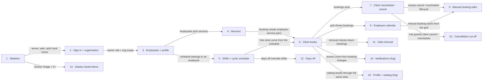

# Roadmap — agent_workflow (telegram-booking)

> **A decomposition, not a promise.** The overall idea broken into incremental steps: what each
> step is, where it comes from, how big it is — or that nobody has looked at it yet — and in which
> order, and parallel lanes, we walk them. **No dates** (except shipped history), **no scores** —
> order is the prioritization. The *solution* for any step lives in its `docs/features/<slug>/`
> spec, not here.

## Destination

A solo-built, deployed closed demo in which an owner registers an organization through the one shared bot, employees set their services and cyclic shift schedules, and a test client books, reschedules and cancels inside a Telegram Mini App, all behind a green CI pipeline.

## Steps

| # | Step | Source | Size | Status |
|---|---|---|:---:|---|
| 1 | Project skeleton: workspace, server, Mini App, bot, migrations, tests, CI, Docker image (`scaffold`) | `architecture-map.md` §Stack · `features/_scaffold/tasks.json` | S | idea |
| 2 | Owner signs in with Telegram (`initData`) and registers the organization (name, phone, address, timezone) | `idea-brief.md` §Онбординг бізнесу · §7. Recommendation | M | idea |
| 3 | Owner invites employees; an employee joins via the bot and fills in their profile (photo, bio, specialization) | `idea-brief.md` §Онбординг бізнесу · §Кабінет працівника | M | idea |
| 4 | Owner manages services (price > 0, duration a multiple of 30 min); each employee picks the services they provide | `idea-brief.md` §Сутності · §Відомі прогалини бізнес-логіки | S | idea |
| 5 | Employee sets one or two shifts with cyclic week templates (up to 4 weeks, own start date per shift) in the org timezone | `idea-brief.md` §Робочий графік: ключова логіка | M | idea |
| 6 | Client books a service: service-first or specialist-first wizard, free-slot search over the next week, overlap check | `idea-brief.md` §Пошук вільного часу · §Запис клієнта | M | idea |
| 7 | Client sees upcoming and past bookings, reschedules and cancels them (status changes, never deletes) | `idea-brief.md` §Кабінет клієнта · §Життєвий цикл запису | S | idea |
| 8 | Employee sees a weekly calendar (days × 30-min slots, ±6 months) and a list of bookings from today | `idea-brief.md` §Кабінет працівника | M | idea |
| 9 | Employee adds a booking by hand in a free slot, edits and cancels bookings, with overlap checks | `idea-brief.md` §Кабінет працівника · §Відомі прогалини бізнес-логіки | S | idea |
| 10 | Cancellation cut-off: a booking cannot be cancelled or rescheduled later than N hours before it starts | `idea-brief.md` §Відомі прогалини бізнес-логіки | XS | idea |
| 11 | Safe removal: deactivating a service or an employee accounts for their future bookings | `idea-brief.md` §Відомі прогалини бізнес-логіки | S | idea |
| 12 | Days off: holidays, sick leave and vacations close an employee's whole day | `idea-brief.md` §Робочий графік: ключова логіка · §8. Open questions | S | idea |
| 13 | Closed demo deployed on public HTTPS with managed Postgres; reachable only by the owner, peers and reviewers | `idea-brief.md` §2. Problem · §7. Recommendation | S | idea |
| 14 | Notifications and reminders → see [Not yet specified](#not-yet-specified) | `idea-brief.md` §Сповіщення (заплановано, не доведено до кінця) | fog | idea |
| 15 | Public organization profile and catalog → see [Not yet specified](#not-yet-specified) | `idea-brief.md` §Вектор розвитку: каталог | fog | idea |

Steps 1–13 are the course month. Steps 14–15 come after it (brief §5 keeps them out of this pass).
**Cut list** if the month runs short: drop *Days off* (12) first, then *Employee edits bookings by hand* (9).
Both sit at the end of the execution path for this reason.

## Not yet specified

| Area | What we'd have to learn | Blocks | How it gets sharpened |
|---|---|:---:|---|
| Notifications and reminders | Which events notify whom through the shared bot, how reminders are scheduled (the foundation has no scheduler or queue), and opt-out | 14 | Recon pass after the course month, then `/sdd:specify` |
| Public profile and catalog | How organizations become public, search by service / city / price / free time, booking across organizations through one bot, reviews and ratings | 15 | Recon pass after notifications; likely its own roadmap |

## Out of scope

- Monetization (subscription, promotion, commission) — a hypothesis for after the catalog, not part of this idea's build (brief §1, §5).
- Owner reports, screen-transition analytics, QR code — deferred by the owner to keep time for quality (brief §5).
- Real businesses and real client data — the demo is closed and synthetic, so no erasure mechanism is needed (brief §5).
- Per-business bots — replaced by one shared bot (brief §5, §7).

## Open decisions

| # | Question | Type | Owner | Blocks |
|---|---|:---:|:---:|:---:|
| D1 | How is an employee's Telegram account bound to the employee record (owner invite link vs verified contact), and how is an organization's first owner established? Does Telegram identity fully replace the password? | grilling | human | 2, 3 |
| D2 | Which host gives public HTTPS for the Mini App plus managed Postgres for one Docker image? | grilling | human | 13 |
| D3 | Migration file naming across parallel lanes: Kysely's Migrator rejects a migration that sorts before an executed one unless `allowUnorderedMigrations` is set ([kysely.dev/docs/migrations](https://kysely.dev/docs/migrations)), so lanes need timestamp-prefixed names or a renumber at merge | task | agent | 4, 5 |
| D4 | What is N for the cancellation cut-off, and does it bind employees as well as clients? | grilling | human | 10 |
| D5 | Baseline for "faster and better": approximate duration and defect list of the earlier attempt | task | human | — |

## Decisions so far

- Core booking only for the course month; notifications, catalog, reports deferred → [`idea-brief.md` §5, §7](idea-brief.md)
- One Telegram Mini App for all three roles behind one shared bot; role resolved server-side → [`idea-brief.md` §5](idea-brief.md)
- TypeScript monorepo with one deployable server → [`ADR-0001`](adr/0001-use-a-typescript-monorepo-with-a-single-deployable-server.md)
- Modular monolith with domain/app/infra/http layers → [`ADR-0002`](adr/0002-use-a-modular-monolith-with-domain-app-infra-http-layers.md)
- PostgreSQL with Kysely and up/down migrations → [`ADR-0003`](adr/0003-use-postgresql-with-kysely-and-up-down-migrations.md)
- Cut list: days off first, then manual booking edits; deployment placed after the core flows → this file, owner decision in the roadmap session

## Dependency graph

## Execution path

All zones are targets from `docs/architecture-map.md`; nothing exists before `scaffold`, so every zone is `(new)`.
Lanes in one wave that both add migrations follow D3.

| Wave | Steps | Zone per step (why parallel-safe) | Unlocks |
|:---:|---|---|---|
| 1 | 1 | whole repo skeleton (new) | 2, 13 |
| 2 | 2 | `apps/server/src/modules/identity/` + `organizations/` + `apps/web/src/pages/owner/` (new) | 3 |
| 3 | 3 | `apps/server/src/modules/staff/` + `apps/web/src/pages/employee/` profile (new) | 4, 5 |
| 4 | 4 ∥ 5 | 4: `modules/services/` + owner services page (new) · 5: `modules/schedule/` + employee schedule page (new) — disjoint modules and pages | 6, 12 |
| 5 | 6 | `modules/booking/` + free-slot search in `schedule/domain/` + `apps/web/src/pages/client/` (new) | 7, 8, 11 |
| 6 | 7 ∥ 8 | 7: `modules/booking/` lifecycle + client bookings pages (new) · 8: `schedule/app` week-grid query + employee calendar page + `apps/web/src/shared/ui/slot-grid/` (new) — disjoint | 9, 10 |
| 7 | 10 ∥ 11 | 10: `modules/booking/domain/` (new) · 11: `modules/services/` + `modules/staff/` (new) — disjoint | — |
| 8 | 9 ∥ 13 | 9: `modules/booking/app` + employee calendar page (new) · 13: deploy config and host setup (new) — disjoint | — |
| 9 | 12 | `modules/schedule/domain/` + employee schedule page (new) — first to cut | — |

## Shipped

| Step | Shipped | Link |
|---|---|---|
